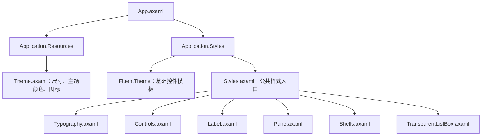

# OneLauncher UI 样式设计与应用说明

本文是 [UI_FI.md](UI_FI.md) 的样式实现说明，依据 2026-10-23 工作区中的 AXAML、控件和资源生成脚本编写。`UI_FI.md` 说明布局和交互约定，本文说明每个样式文件、每条选择器及其实际应用点。修改公共样式前，应同时阅读两份文档和 `docs/AI_Instruction/前端设计规范.md`。

当前真实样式目录是 `OneLauncher/Styles`，共 8 个 AXAML 文件、88 个 `<Style>` 元素；`Theme.axaml` 另外定义 4 个公共尺寸资源，以及 Light/Dark 各 50 个资源。逗号连接的选择器按一个 `<Style>` 元素计数，下文仍解释其全部匹配分支。

`UI_FI.md` 中部分目录说明使用重构前的 `Views/Styles`、`Views/Controls`、`Views/ViewModels` 路径。目前对应物理目录分别为 `Styles`、`Controls`、`ViewModels`，页面位于 `Views/Pages`；代码命名空间仍可使用 `OneLauncher.Views.Controls` 等旧名称。查找文件时应以当前物理目录为准。

文中的“应用点”指源代码中实际声明的控件、类名、模板或资源引用。类名对应的规则不要求页面重新加载样式文件；状态选择器和 `/template/` 规则通过其所属控件间接应用。业务绑定的显隐、状态和命令不由 Style 决定。

## 1. UI 设计的分层与加载入口

### 1.1 文件职责及影响范围

| 文件 | Style 数 | 职责 | 修改后影响的界面 |
|---|---:|---|---|
| [Theme.axaml](../../OneLauncher/Styles/Theme.axaml) | 0 | 主题资源字典：颜色、尺寸和深浅色图标 | 所有引用对应资源的页面、Pane、模板和窗口 |
| [Styles.axaml](../../OneLauncher/Styles/Styles.axaml) | 0 | 按固定顺序聚合六个样式文件 | 应用级公共样式的加载范围与覆盖顺序 |
| [Typography.axaml](../../OneLauncher/Styles/Typography.axaml) | 5 | 页面与卡片的文字层级 | 页面标题、副标题、分区标题、项目标题和元信息 |
| [Controls.axaml](../../OneLauncher/Styles/Controls.axaml) | 27 | 通用按钮、徽章、搜索框、设置控件和 Flyout 表面 | 页面工具栏、列表操作、状态标签、设置与弹出菜单 |
| [Label.axaml](../../OneLauncher/Styles/Label.axaml) | 4 | 无底色的链接按钮 | 游戏数据标签删除入口、设置页 GitHub 链接 |
| [Pane.axaml](../../OneLauncher/Styles/Pane.axaml) | 37 | Pane 表单、内容表面、操作和任务卡片 | 13 个 Pane，及公共 PaneHeader 模板中的标题、返回按钮 |
| [Shells.axaml](../../OneLauncher/Styles/Shells.axaml) | 2 | `PageShell`、`PaneHeader` 的完整控件模板 | 8 个主页面的模态任务层、13 个 Pane 的统一头部 |
| [TransparentListBox.axaml](../../OneLauncher/Styles/TransparentListBox.axaml) | 13 | 卡片列表容器、卡片表面和选中/悬浮/按下状态 | 页面卡片列表和任务中心列表 |

### 1.2 实际加载链

[App.axaml](../../OneLauncher/App.axaml) 在 `Application.Resources` 中合并 `Theme.axaml`；在 `Application.Styles` 中先加载 `FluentTheme`，再加载 `Styles.axaml`。FluentTheme 提供基础控件模板，项目样式在这些模板和默认属性上定义自己的视觉表现。



`Styles.axaml` 中没有 Setter，六条 `StyleInclude` 的作用如下，顺序与源码一致：

| 顺序 | 引入文件 | 作用 |
|---:|---|---|
| 1 | `Typography.axaml` | 先定义页面文字层级 |
| 2 | `Controls.axaml` | 定义通用操作和状态控件 |
| 3 | `Label.axaml` | 定义链接按钮的透明表面及文字反馈 |
| 4 | `Pane.axaml` | 定义 Pane 专用类名和任务视觉规则 |
| 5 | `Shells.axaml` | 定义两个公共模板，模板内部继续使用 Pane 类名和主题资源 |
| 6 | `TransparentListBox.axaml` | 定义卡片列表；任务中心中的列表卡片会同时匹配 Pane 与列表规则 |

页面和 Pane 不应再次添加这些 `StyleInclude`。公共规则在应用级加载一次；新闻卡片等只属于特定页面的规则，仍放在页面或局部容器的 `.Styles` 中。

### 1.3 视觉结构分析

主窗口底材与导航、中央页面、页面卡片、模态 Pane、Flyout 分别承担不同层级。`MainWindowBackgroundBrush` 保留半透明窗口背景；`PageBackgroundBrush` 保证中央主要内容不透明；卡片有独立表面、边框和阴影；Pane 覆盖原页面，打开时原页面禁用并加遮罩；Flyout 使用半透明表面与边框。

页面通常通过“32 号页面标题 → 22 号分区标题 → 18 号项目标题 → 12/13 号辅助文字”建立信息层级。Pane 使用另一组较紧凑的标题和表单字号，避免把页面排版直接套到任务表单中。

公共按钮和卡片用背景、阴影、透明度变化提供反馈。当前公共样式没有使用 ScaleTransform 放大卡片，符合 `UI_FI.md` 对布局稳定性的要求。样式负责视觉反馈，打开任务、取消下载、保存数据等行为仍由 ViewModel 命令负责。

## 2. 如何理解选择器、资源与覆盖

### 2.1 选择器读法

| 写法 | 含义 | 本项目例子 |
|---|---|---|
| `控件类型.类名` | 指定类型且具有该类名的控件 | `Button.toolbar-action`，对应 `<Button Classes="toolbar-action">` |
| `.类名1.类名2` | 同一控件同时具有两个类名 | `Border.status-badge.warning`，对应 `Classes="status-badge warning"` |
| `:pointerover` / `:pressed` / `:selected` | 控件处于对应交互状态时应用 | 工具栏悬浮、按钮按下、列表项选中 |
| 两段之间为空格 | 匹配后代；可能跨越中间容器 | `Button.toolbar-action StackPanel` 会影响按钮内容中的后代 StackPanel |
| `>` | 匹配直接子控件 | `Border.status-badge > TextBlock` 要求文字直接放在徽章 Border 中 |
| `/template/` | 进入前一个控件的模板，匹配模板内的控件 | `Button.toolbar-action /template/ ContentPresenter` 修改按钮模板表面 |
| 逗号 | 同一组 Setter 用于多个匹配分支 | 链接按钮的悬浮和按下共用规则 |
| `controls\|PageShell` | 匹配指定 XAML 命名空间中的自定义控件 | `Shells.axaml` 声明的 `controls` 对应 `OneLauncher.Views.Controls` |

`Classes` 可以叠加视觉角色，但不同类型不能只凭同名类就假定匹配。例如 `SplitButton Classes="Accent"` 不会因其是操作按钮而自动匹配 `Button.item-action`；任务中心的 `PathIcon Classes="task-icon running"` 没有四条独立的状态 Style，其尺寸来自 `Border.task-status-icon PathIcon`，状态来自显隐与颜色绑定。

### 2.2 Setter、模板表面与本地属性

样式中的尺寸和颜色是默认规则。页面直接声明的属性或绑定可以覆盖对应普通 Style Setter。例如下载页的 `TextBlock.item-title` 显式设置 `FontSize="15"`，因此该位置采用 15 而不是公共默认值 18；游戏数据标签 Flyout 的 `section-title` 显式设置 18，而不是默认值 22。

对按钮本体设置 `Background`，与对模板中的 `ContentPresenter` 设置 `Background`，是两个不同控件上的属性赋值。因此项目既定义按钮本体的常态背景，也定义模板表面的悬浮和按下背景；仅修改本体，不能保证所有模板交互状态都会采用该颜色。

多个样式同时匹配时，应结合属性优先级、状态规则、作用域和定义顺序阅读源码，不把本项目的类名体系当作 CSS 的级联规则使用。本文每条规则的数值是它声明的默认值，最终画面还取决于页面显式属性和同时匹配的其他规则。

### 2.3 StaticResource 与 DynamicResource

`StaticResource` 用于公共圆角等固定尺寸；`DynamicResource` 用于主题颜色和图标，主题切换后可重新解析。`Theme.axaml` 的 Light/Dark 使用同名键，应用保持 `RequestedThemeVariant="Default"`，控件依据实际继承或指定的主题取得对应资源。

资源“被定义”不代表“被应用”。第 3 节逐个标明资源的消费者，未引用的键仍保留并明确标注；修改这些键不会自动改变当前页面。

## 3. Theme.axaml：全部资源的作用与应用点

该文件是 `ResourceDictionary`，没有 `<Style Selector=...>`。它集中定义被样式和视图引用的值，图标也已合并到其 Light/Dark 字典中，不再有独立的 `Icons.axaml`。

### 3.1 公共尺寸资源：4 个

| 资源键 | 类型与值 | 设计作用 | 当前应用点 |
|---|---|---|---|
| `PagePadding` | Thickness，24 | 页面内容的统一内边距定义 | 当前业务 AXAML/C# 未引用；页面实际仍使用本地 Margin/Padding |
| `PanePadding` | Thickness，20 | Pane 内容的统一内边距定义 | 当前业务 AXAML/C# 未引用；多数 Pane 直接写 `Margin="20"` |
| `ControlCornerRadius` | CornerRadius，6 | 输入框、小按钮等普通控件圆角 | `Controls.axaml` 的 item-action、danger-action、search-field；`Pane.axaml` 的操作按钮和输入框 |
| `CardCornerRadius` | CornerRadius，8 | 内容表面和列表卡片圆角 | `Border.pane-surface`、`ListBox.card-list ListBoxItem > Border` |

不要认为修改 `PagePadding` 或 `PanePadding` 会改变当前页面间距；需先使具体页面引用该键。

### 3.2 主题画刷：29 个键，每个都有 Light/Dark 值

下面的颜色采用源码中的 `#AARRGGBB` 表示法。表中的应用点包含样式消费者和视图的直接引用。

| 资源键 | Light | Dark | 作用与实际应用点 |
|---|---|---|---|
| `MainWindowBackgroundBrush` | `#99FFFFFF` | `#99181820` | 主窗口半透明底材；`MainWindow.axaml` 的 Window.Background |
| `PageBackgroundBrush` | `#FFFFFFFF` | `#FF1D1E21` | 中央页面的不透明背景；主窗口 `PageContent` 的 TransitioningContentControl.Background |
| `PaneBackgroundBrush` | `#F2F6F7FA` | `#F017181B` | 任务层背景；PageShell 模板中 SplitView.Pane 与 Pane 内容承载控件；Home 右侧启动区域也直接使用 |
| `GlassBorderBrush` | `#A6FFFFFF` | `#38FFFFFF` | 半透明表面边框；FlyoutPresenter、MenuFlyoutPresenter、pane-surface |
| `FlyoutBackgroundBrush` | `#E8FFFFFF` | `#E827282D` | 弹出层表面；Controls 中两种 Flyout Presenter |
| `ModalScrimBrush` | `#42000000` | `#70000000` | Pane 打开时覆盖原页面的遮罩；PageShell 模板中的 Border.Background |
| `ListItemBackgroundBrush` | `#FFF7F7F9` | `#FF2C2D32` | 工具栏按钮与内容卡片常态表面；toolbar-action、pane-surface、卡片列表 Border |
| `CardBackgroundBrush` | `#FFF5F5F7` | `#FF292A2F` | 次要按钮和小型表面；pane-secondary、task-status-icon；Home 卡片及 EditGameData/EditServer 图标预览框 |
| `CardHoverBrush` | `#FFFFFFFF` | `#FF38393F` | 悬浮时提高表面亮度；toolbar-action、pane-surface、列表卡片的 pointerover 规则 |
| `InputBackgroundBrush` | `#FFFFFFFF` | `#FF242529` | Pane 文本输入底色；`TextBox.pane-field` |
| `ControlHoverBrush` | `#0F000000` | `#14FFFFFF` | 透明或次要操作按钮的悬浮底色；pane-toolbar、pane-secondary |
| `ControlPressedBrush` | `#18000000` | `#20FFFFFF` | 操作按下反馈；toolbar-action 和 pane-toolbar 的模板表面 |
| `BorderSubtleBrush` | `#1F000000` | `#2BFFFFFF` | 内容分界、普通细边框；工具栏、pane-secondary、task-status-icon、卡片列表、两种分隔线 |
| `PrimaryForegroundBrush` | `#FF202124` | `#FFF6F7F9` | 主信息颜色；Typography 标题、Pane 标题、普通操作按钮；Home 标题直接使用 |
| `SecondaryForegroundBrush` | `#FF65676D` | `#FFB0B2B8` | 辅助说明颜色；page-subtitle、item-meta、pane-label/help、task-status-label/current；Home 说明、资源检索描述 |
| `MutedForegroundBrush` | `#FF7C7F86` | `#FF93969D` | 更弱的文字颜色定义；当前业务 AXAML/C# 未引用 |
| `AccentBrush` | `#FF007AFF` | `#FF0A84FF` | 主操作和普通状态强调色；pane-primary、pane-status、普通徽章、link-button；Home 联机与导入区域 |
| `HyperlinkHoverForegroundBrush` | `#FF800080` | `#FFC084FC` | 链接悬浮/按下文字颜色；Label 中两组状态规则 |
| `AccentHoverBrush` | `#14007AFF` | `#240A84FF` | 低透明度强调表面；普通 status-badge、pane-status；Home 本地 Link 的悬浮背景 |
| `AccentPressedBrush` | `#26007AFF` | `#380A84FF` | 强调色按下表面定义；当前业务 AXAML/C# 未引用。现有按钮按下规则采用其他资源或 Opacity |
| `OnAccentBrush` | `#FFFFFFFF` | `#FF08111A` | 实心强调表面上的文字颜色定义；目前用于 danger-action；pane-primary/pane-danger 则显式使用 White |
| `SelectionBackgroundBrush` | `#18007AFF` | `#300A84FF` | 选中表面定义；当前业务 AXAML/C# 未引用，card-list 的选中视觉没有使用它 |
| `DangerBrush` | `#FFC42B1C` | `#FFFF5F52` | 危险操作、异常状态；danger-action、pane-danger、danger 徽章的边框与文字 |
| `DangerHoverBrush` | `#FFA42618` | `#FFFF7B70` | 危险按钮悬浮颜色；danger-action、pane-danger 的模板表面 |
| `DangerSubtleBrush` | `#18C42B1C` | `#2BFF5F52` | 异常徽章的低透明度背景；status-badge.danger |
| `WarningBrush` | `#FF8A5A00` | `#FFFFC857` | 警示徽章的边框和文字；游戏数据默认标记、任务中心已取消标记 |
| `WarningSubtleBrush` | `#1FD18B00` | `#2BFFC857` | 警示徽章背景；status-badge.warning |
| `SuccessBrush` | `#FF107C10` | `#FF54C76B` | 成功状态徽章；联机已连接、任务已完成；Home 任务中心卡片色条和进入按钮 |
| `SuccessSubtleBrush` | `#19107C10` | `#2854C76B` | 成功徽章背景；status-badge.success |

`TaskCenterPane` 的进度条、状态图标和进度表面采用 ViewModel 的 `ProgressBrush`、`ProgressSurfaceBrush` 绑定；`InstallModPane` 也绑定自己的状态画刷。这些是本地绑定值，不能把修改 Theme 中同名语义颜色理解为必然改变这些业务状态表面。任务中心的状态徽章仍由上述主题画刷控制。

### 3.3 主题图标：21 个键，每个都有两张图片

Light 使用 `avares://OneLauncher/Assets/icos/<文件名>`，Dark 使用对应 `icos/white/<文件名>`。图标通过 `<Bitmap x:Key="...">avares://...</Bitmap>` 声明，消费者使用 `Image.Source="{DynamicResource ...}"`，不依赖 TextBlock.Foreground 改变位图颜色。

| 资源键 | 原图文件 | 含义与实际应用点 |
|---|---|---|
| `IconAccount` | `account.png` | 主窗口账户导航 |
| `IconAdd` | `add.png` | 账户新建、游戏数据新建、服务器添加、版本条目创建游戏数据 |
| `IconBack` | `back.png` | Shells 中 PaneHeader 返回按钮；间接覆盖所有采用 PaneHeader 的 Pane |
| `IconBrowser` | `browser.png` | 主窗口资源检索导航；游戏数据模组管理入口；版本操作中的服务端目录与详细信息入口 |
| `IconDel` | `del.png` | 账户删除、资源检索清除、编辑游戏数据/服务器的删除按钮 |
| `IconDownload` | `download.png` | 主窗口下载导航 |
| `IconDownloadnow` | `downloadnow.png` | 下载图标资源；当前业务 AXAML/C# 未引用 |
| `IconEdit` | `edit.png` | 游戏数据与服务器列表中的编辑入口 |
| `IconError` | `error.png` | ExceptionTip 异常窗口 |
| `IconGame` | `game.png` | 主窗口游戏数据导航 |
| `IconHome` | `home.png` | 主窗口主页导航 |
| `IconInternet` | `internet.png` | DownloadPane 头部弹出操作 |
| `IconLaunch` | `launch.png` | Home 快速游戏、游戏数据启动、服务器启动、版本根启动与一键开服 |
| `IconPin` | `pin.png` | 账户、游戏数据和服务器的设为默认操作 |
| `IconRefresh` | `refresh.png` | 账户刷新；GameDataModsManagerPane 刷新 |
| `IconSave` | `save.png` | EditGameDataPane 与 EditServerPane 保存按钮 |
| `IconSearch` | `search.png` | ModsBrowser 搜索按钮 |
| `IconServer` | `server.png` | 主窗口服务器导航；版本操作菜单的服务端分组 |
| `IconSettings1` | `settings1.png` | 主窗口设置导航；游戏数据与版本管理工具按钮、版本条目操作入口 |
| `IconSkin` | `skin.png` | 账户列表中的皮肤管理入口 |
| `IconVersion` | `version.png` | 主窗口版本管理导航 |

[Generate-ThemeIcons.ps1](../../scripts/Generate-ThemeIcons.ps1) 保留图片尺寸和 alpha，生成白色副本，并仅更新 Theme 中 `BEGIN GENERATED ICONS: Light/Dark` 与相应 END 标记之间的内容。新增/替换 PNG 后运行脚本并提交生成结果；不要手工维护另一份图标字典。图标名称以字母开头，只含字母和数字，资源键由文件名派生。

窗口 logo、账户头像、实例图标和远程资源图片不是这组界面操作图标。任务状态 PathIcon 使用矢量 Data 与颜色绑定，也不经过该位图生成脚本。

### 3.4 矢量路径文本：SKGT.resx

矢量文本统一保存在 [SKGT.resx](../../OneLauncher/Assets/Resources/SKGT.resx)，由 [VectorIcons.cs](../../OneLauncher/Assets/Resources/VectorIcons.cs) 读取强类型资源并缓存 Geometry。它不属于 Theme.axaml 的位图资源键，不需要为 Light/Dark 复制几何路径；颜色仍由 PathIcon.Foreground 的主题或状态绑定决定。

Home 新闻翻页引用 `VectorIcons.ChevronLeft/ChevronRight`，TaskCenterPane 引用 `TaskRunning/TaskStopped/TaskCompleted`。下载、模组/光影安装、整合包安装的 ViewModel 使用 `StatusRunning/StatusCompleted/StatusCanceled/StatusFailed`。AXAML 用 `Data="{x:Static icons:VectorIcons.ChevronLeft}"` 等方式取得 Geometry，其中 icons 指向 `using:OneLauncher.Assets.Resources`。

新增图形时在 resx 增加字符串键，在 VectorIcons 增加解析后的 Geometry 属性，视图或 ViewModel 引用该属性。不要在界面文件中复制原始路径，也不要手改 obj 下自动生成的 SKGT.Designer.cs。资源配置、应用点与验证详见 [SKGT 矢量文本资源迁移](SKGT矢量文本资源迁移-20261023.md)。

## 4. Typography.axaml：5 条文字样式

| 编号 | 选择器 | Setter 与设计作用 | 实际应用点 |
|---:|---|---|---|
| T1 | `TextBlock.page-title` | FontSize=32，SemiBold，PrimaryForegroundBrush，VerticalAlignment=Center。建立页面最上层标题并与工具栏按钮垂直对齐 | account、download、gamedata、ModsBrowser、server、settings、version 的页面标题；Home 使用自己的卡片标题，没有该类名 |
| T2 | `TextBlock.page-subtitle` | FontSize=13，SecondaryForegroundBrush，TextWrapping=Wrap。让长说明换行而不与主标题争夺视觉层级 | account 的第三方 API/皮肤延迟说明；download 的版本搜索说明 |
| T3 | `TextBlock.section-title` | FontSize=22，SemiBold，PrimaryForegroundBrush。划分页面内容板块 | settings 的界面、游戏启动、下载、运行环境、关于及导航编辑 Flyout 标题；gamedata 新建标签 Flyout，后者本地覆盖字号为 18 |
| T4 | `TextBlock.item-title` | FontSize=18，SemiBold，PrimaryForegroundBrush。突出一条记录的名称 | 账户名称、游戏实例名称、资源名称、服务器名称、版本号、下载版本 ID、任务名称；download 本地字号为 15 |
| T5 | `TextBlock.item-meta` | FontSize=12，SecondaryForegroundBrush，TextTrimming=CharacterEllipsis。用于次级元信息，空间不足时字符省略 | 账户类型/标识符，游戏版本/加载器/标识符，服务器描述/Ping/人数/实例标识符，版本添加时间，ModsBrowser 搜索状态 |

这些选择器只匹配相应类名的 `TextBlock`。例如资源描述使用 `SelectableTextBlock` 并直接引用 SecondaryForegroundBrush，不属于 T5；开启换行、限制行数、是否显示标识符等仍由页面属性和绑定决定。

## 5. Controls.axaml：27 条通用控件样式

### 5.1 页面工具栏：C1–C7

这组规则用于 account 的新建/刷新、gamedata 的新建/重置筛选/工具入口、ModsBrowser 的搜索/清除、server 的添加、version 的工具按钮，以及 settings 导航编辑 Flyout 中的保存并应用。

| 编号 | 选择器 | Setter 与作用 | 匹配的应用点 |
|---:|---|---|---|
| C1 | `Button.toolbar-action` | MinHeight=40，Padding=12,7，CornerRadius=8；ListItemBackgroundBrush 背景、PrimaryForegroundBrush 文字、BorderSubtleBrush 的 1 像素边框；FontWeight=Medium，水平/垂直内容居中。形成页面常用操作的统一表面 | 上述声明 toolbar-action 的 Button 本体 |
| C2 | `Button.toolbar-action /template/ ContentPresenter` | 常态阴影 `0 3 10 1 #32000000`；Background、BorderBrush 和 BoxShadow 各有 0.14 秒 Transition。使按钮表面状态切换平滑 | 上述按钮的 Fluent 模板 ContentPresenter，页面不需自行创建 Presenter |
| C3 | `Button.toolbar-action:pointerover /template/ ContentPresenter` | Background=CardHoverBrush，BorderBrush=BorderSubtleBrush，阴影提高到 `0 6 16 1 #42000000`。悬浮时增强表面与层级 | toolbar-action 的悬浮状态 |
| C4 | `Button.toolbar-action:pressed /template/ ContentPresenter` | Background=ControlPressedBrush，阴影降低到 `0 1 5 0 #26000000`。表达按下反馈 | toolbar-action 的按下状态 |
| C5 | `Button.toolbar-action StackPanel` | Orientation=Horizontal，Spacing=7，水平/垂直对齐 Center。统一图文操作排列 | account、gamedata、ModsBrowser、server、version 工具按钮的内容 StackPanel；settings 纯 Content 文字按钮没有这层容器 |
| C6 | `Button.toolbar-action StackPanel > Image` | VerticalAlignment=Center。把图标与文字中心线对齐 | C5 的直接子 Image；图标尺寸和资源键由视图提供 |
| C7 | `Button.toolbar-action StackPanel > TextBlock` | VerticalAlignment=Center，FontWeight=Medium。统一图文按钮文字 | C5 的直接子 TextBlock |

C5 匹配按钮中的后代 StackPanel，范围比“仅最外层内容面板”更宽。复杂按钮内容不应无意嵌套多个需要垂直排版的 StackPanel；如需这种结构，应明确布局属性。

### 5.2 条目操作与危险操作：C8–C12

| 编号 | 选择器 | Setter 与作用 | 实际应用点 |
|---:|---|---|---|
| C8 | `Button.item-action` | MinHeight=32，Padding=10,5，CornerRadius=ControlCornerRadius，VerticalContentAlignment=Center。用于较紧凑的条目/次级操作；没有自定义常态背景或完整模板 | account 设默认/皮肤/删除，download 下载，gamedata 设默认/模组管理/编辑，ModsBrowser 安装，server 设默认/编辑；settings 导航配置入口也使用 |
| C9 | `Button.item-action StackPanel > Image` | VerticalAlignment=Center。对齐条目按钮的直接图标子控件 | account、gamedata、server 的图文 item-action；纯文字按钮无此应用点 |
| C10 | `Button.item-action StackPanel > TextBlock` | VerticalAlignment=Center。对齐条目按钮文字 | 上述图文按钮及 ModsBrowser 安装按钮内容中的 TextBlock |
| C11 | `Button.danger-action` | Background/BorderBrush=DangerBrush，Foreground=OnAccentBrush，BorderThickness=1，CornerRadius=ControlCornerRadius。强调危险操作；不独立规定高度与 Padding | account 删除按钮，同时具有 `item-action danger-action`；尺寸由 C8 提供 |
| C12 | `Button.danger-action:pointerover /template/ ContentPresenter` | Background=DangerHoverBrush，Foreground=OnAccentBrush。危险按钮的悬浮反馈 | account 删除按钮的模板表面 |

`item-action` 不统一内容面板的方向或间距，视图通常自己写 `Orientation="Horizontal"` 和 Spacing。version 条目的根启动、创建游戏数据、操作按钮目前没有 `item-action`，继续采用基础主题表现；gamedata 的 SplitButton 与 server 启动按钮使用 `Accent`，也应单独阅读。

### 5.3 状态徽章：C13–C20

| 编号 | 选择器 | Setter 与作用 | 实际应用点 |
|---:|---|---|---|
| C13 | `Border.status-badge` | Background=AccentHoverBrush，BorderBrush=AccentBrush，BorderThickness=1，CornerRadius=4，Padding=8,4，VerticalAlignment=Center。普通强调徽章的形状与基色 | account/server 默认标记，version 的 Fabric/NeoForge/Forge/Quilt 标记，TaskCenterPane 运行中；warning/danger/success 变体也保留此形状规则 |
| C14 | `Border.status-badge.warning` | Background=WarningSubtleBrush，BorderBrush=WarningBrush。警示/非完成状态颜色 | gamedata 默认实例标记；TaskCenterPane 已取消 |
| C15 | `Border.status-badge.danger` | Background=DangerSubtleBrush，BorderBrush=DangerBrush。异常状态颜色 | TaskCenterPane 异常 |
| C16 | `Border.status-badge.success` | Background=SuccessSubtleBrush，BorderBrush=SuccessBrush。成功状态颜色 | PowerPlayPane 已连接；TaskCenterPane 已完成 |
| C17 | `Border.status-badge > TextBlock` | FontSize=12，SemiBold，Foreground=AccentBrush。普通徽章文字 | 所有普通徽章的直接子 TextBlock；变体文字还匹配下面的颜色规则 |
| C18 | `Border.status-badge.warning > TextBlock` | Foreground=WarningBrush。让警示文字与边框颜色一致 | C14 徽章文字 |
| C19 | `Border.status-badge.danger > TextBlock` | Foreground=DangerBrush。让异常文字与边框颜色一致 | C15 徽章文字 |
| C20 | `Border.status-badge.success > TextBlock` | Foreground=SuccessBrush。让成功文字与边框颜色一致 | C16 徽章文字 |

徽章的状态不是由 Style 推断的：当前页面使用多个徽章结合 `IsVisible` 绑定显示。新增徽章时文字应直接放在 Border 内；若中间增加 Grid/StackPanel，C17–C20 的直接子选择器不会匹配该文字。

### 5.4 搜索、设置和弹出表面：C21–C27

| 编号 | 选择器 | Setter 与作用 | 实际应用点 |
|---:|---|---|---|
| C21 | `TextBox.search-field` | MinHeight=38，CornerRadius=ControlCornerRadius。统一普通搜索输入尺寸 | ModsBrowser 的资源检索输入框 |
| C22 | `AutoCompleteBox.search-field` | MinHeight=38，CornerRadius=ControlCornerRadius。给自动完成搜索相同高度与圆角 | download 的 Minecraft 版本搜索 |
| C23 | `NumericUpDown.settings-number` | Width=150，HorizontalAlignment=Left，Margin=0,6,0,0。统一设置页数字输入宽度与标签间距 | settings 左侧导航间距、最大下载线程、最大 SHA1 校验线程；范围和值由视图/绑定规定 |
| C24 | `Separator.section-divider` | Background=BorderSubtleBrush，Margin=0,8,0,0。页面分区标题下的细分隔 | settings 的各个设置板块及关于 |
| C25 | `StackPanel.settings-section` | Spacing=8，HorizontalAlignment=Stretch，MaxWidth=760。控制每个设置板块的内容间距和最大宽度 | settings 的界面、游戏启动、下载、运行环境、关于；分类显隐由 IsVisible 绑定决定 |
| C26 | `FlyoutPresenter` | Background=FlyoutBackgroundBrush，BorderBrush=GlassBorderBrush，BorderThickness=1，CornerRadius=12。全局普通 Flyout 表面 | settings 的 SettingsFlyout；gamedata 新建标签/工具 Flyout；version 工具 Flyout。SettingsFlyout 继承 Flyout，其显示表面仍由 Presenter 负责 |
| C27 | `MenuFlyoutPresenter` | 与 C26 相同的背景、边框和圆角。统一菜单型 Flyout | version 的条目操作 MenuFlyout；gamedata 的 SplitButton.Flyout 菜单 |

这两条 Presenter 规则没有类名过滤，影响应用中的对应类型。它们只改变弹出层的视觉属性，不决定 Placement、关闭条件、菜单项或 ViewModel 的编辑/保存生命周期。`ContextMenu` 不应仅凭它是弹出菜单就被当作 C27 的直接匹配对象。

## 6. Label.axaml：4 条链接按钮样式

该文件名虽然叫 Label，实际定义的是 `Button.link-button`，没有为 Avalonia Label 控件设置样式。链接仍是 Button，可继续使用 Command、焦点和按钮交互，不需要用可点击 TextBlock 模拟。

| 编号 | 选择器 | Setter 与作用 | 实际应用点 |
|---:|---|---|---|
| L1 | `Button.link-button` | Background=Transparent，Foreground=AccentBrush，BorderThickness=0，Padding=0，MinWidth/MinHeight=0；VerticalAlignment=Center，HorizontalContentAlignment=Left，Cursor=Hand。将普通按钮变为紧凑的文字链接 | gamedata 标签项的删除入口；settings 关于区域的 GitHub 按钮 |
| L2 | `Button.link-button /template/ ContentPresenter` | Background/BorderBrush=Transparent，BorderThickness=0。清除模板层的普通按钮表面 | L1 按钮的 ContentPresenter |
| L3 | `Button.link-button:pointerover, Button.link-button:pressed` | 两个状态分支都设置 Foreground=HyperlinkHoverForegroundBrush。通过文字颜色反馈悬浮或按下 | L1 按钮本体的两种交互状态 |
| L4 | `Button.link-button:pointerover /template/ ContentPresenter, Button.link-button:pressed /template/ ContentPresenter` | 两个模板状态分支都保持 Background/BorderBrush=Transparent，Foreground=HyperlinkHoverForegroundBrush。避免模板状态重新出现底色 | L1 的模板表面及其两种交互状态 |

Home 导入区域的 `Button.Link` 是局部样式，具有自己的 Padding 和悬浮背景，不属于本文件。类名大小写及拼写应按源码使用，不能把 `Link` 和 `link-button` 当作同一规则。

## 7. Pane.axaml：37 条 Pane 与任务样式

### 7.1 Pane 应用范围说明

当前全部 13 个 Pane 都使用 `PaneHeader`、`pane-divider` 和至少一个 `pane-surface`：AddServerPane、DownloadPane、EditGameDataPane、EditServerPane、GameDataModsManagerPane、InitServerPane、InstallModPane、JavaInstallPane、NewGameDataPane、PowerPlayPane、SkinMangerPane、TaskCenterPane、UserModelLoginPane。文件均位于 `OneLauncher/Views/Panes`。

每个 Pane 通常是“统一头部 → 分隔线 → 可滚动任务内容 → 底部操作”的 Grid。具体列宽、MaxWidth、ScrollViewer、字段绑定和操作可见性仍写在视图中，不能仅添加一个类名就得到完整表单布局。

### 7.2 文字、分隔和内容表面：P1–P8

| 编号 | 选择器 | Setter 与作用 | 实际应用点 |
|---:|---|---|---|
| P1 | `TextBlock.pane-title` | FontSize=24，Bold，PrimaryForegroundBrush，VerticalAlignment=Center。突出任务标题 | Shells 中 PaneHeader 模板的标题 TextBlock；所有 Pane 经模板间接使用 |
| P2 | `TextBlock.pane-section-title` | FontSize=14，SemiBold，PrimaryForegroundBrush。划分任务内部的字段组/步骤 | 除 GameDataModsManagerPane 外的 12 个 Pane 的分区标题；TaskCenterPane 还用于“暂无任务” |
| P3 | `TextBlock.pane-label` | FontSize=13，SemiBold，SecondaryForegroundBrush。标明输入字段含义 | AddServer、EditGameData、EditServer、InstallMod、JavaInstall、NewGameData、PowerPlay、SkinManger 的字段标签 |
| P4 | `TextBlock.pane-help` | FontSize=12，SecondaryForegroundBrush，TextWrapping=Wrap。让解释或辅助信息较弱且能换行 | AddServer、Download、EditGameData、EditServer、GameDataModsManager、InitServer、InstallMod、JavaInstall、TaskCenter、UserModelLogin 的说明、版本信息或进度辅助信息 |
| P5 | `Separator.pane-divider` | Background=BorderSubtleBrush，Margin=0,16。将头部和内容隔开，上下各留 16 | 全部 13 个 Pane 的头部分隔线 |
| P6 | `Border.pane-surface` | Background=ListItemBackgroundBrush，BorderBrush=GlassBorderBrush，BorderThickness=1，CornerRadius=CardCornerRadius，Padding=16；阴影 `0 3 12 0 #28000000`；Background 和 BoxShadow 各有 0.16 秒 Transition。形成独立表单/信息卡片 | 全部 13 个 Pane 的分组表面；GameDataModsManager 的模组条目、TaskCenter 的任务条目也复用 |
| P7 | `Border.pane-surface:pointerover` | Background=CardHoverBrush，阴影提高到 `0 6 18 0 #34000000`。提供表面悬浮反馈 | P6 的悬浮状态；只提供视觉反馈，不意味着 Border 有点击命令 |
| P8 | `Border.pane-status` | Background=AccentHoverBrush，BorderBrush=AccentBrush，BorderThickness=1，CornerRadius=6，Padding=14。为进度/状态信息建立强调表面 | DownloadPane、InstallModPane、JavaInstallPane 的状态区；TaskCenterPane 的空状态。InstallMod/JavaInstall 的本地状态绑定可覆盖默认背景/边框 |

`pane-label` 与 `pane-help` 都使用辅助颜色，但前者半粗体、用于字段名称，后者正常文字、允许换行。`pane-surface` 为一般内容，`pane-status` 为任务状态，两者的背景、圆角、Padding 和阴影职责不同。

### 7.3 头部操作：P9–P15

| 编号 | 选择器 | Setter 与作用 | 实际应用点 |
|---:|---|---|---|
| P9 | `Button.pane-toolbar` | MinHeight=36，Padding=10,7，Background=Transparent，Foreground=PrimaryForegroundBrush，BorderThickness=0，CornerRadius=ControlCornerRadius，水平/垂直内容居中。轻量任务头部按钮 | PaneHeader 的公共返回按钮；DownloadPane 的弹出按钮；GameDataModsManagerPane 的刷新按钮 |
| P10 | `Button.pane-toolbar /template/ ContentPresenter` | Background 的 Transition 为 0.14 秒。平滑头部按钮表面变化 | P9 的模板 ContentPresenter |
| P11 | `Button.pane-toolbar:pointerover /template/ ContentPresenter` | Background=ControlHoverBrush。透明头部操作的悬浮反馈 | P9 的悬浮状态 |
| P12 | `Button.pane-toolbar:pressed /template/ ContentPresenter` | Background=ControlPressedBrush。头部操作的按下反馈 | P9 的按下状态 |
| P13 | `Button.pane-toolbar StackPanel` | Orientation=Horizontal，Spacing=7，VerticalAlignment=Center。排列图文工具内容 | DownloadPane 弹出、GameDataModsManagerPane 刷新的内容 StackPanel；公共返回按钮内部使用 Grid，不匹配此条 |
| P14 | `Button.pane-toolbar StackPanel > Image` | VerticalAlignment=Center。对齐工具内容的直接子图标 | P13 的图标；公共返回图标的对齐由 Shells 模板直接声明 |
| P15 | `Button.pane-toolbar StackPanel > TextBlock` | VerticalAlignment=Center，FontWeight=Medium。对齐工具内容文字 | P13 的直接子 TextBlock |

GameDataModsManager 刷新内容显式设置 Spacing=8，因此该位置不使用 P13 默认的 7。公共返回按钮使用两列 Grid，保留图标与返回文字的独立列宽。

### 7.4 主操作、次操作、危险操作：P16–P22

| 编号 | 选择器 | Setter 与作用 | 实际应用点 |
|---:|---|---|---|
| P16 | `Button.pane-primary` | MinHeight=40，Padding=16,8，Background=AccentBrush，Foreground=White，SemiBold，CornerRadius=ControlCornerRadius。强调任务的主要执行/提交动作 | AddServer 添加，Download 安装，EditGameData/EditServer 保存，InitServer 安装启动，InstallMod 安装，JavaInstall 安装，NewGameData 创建，PowerPlay 创建/加入，SkinManger 保存，UserModelLogin 登录 |
| P17 | `Button.pane-primary:pointerover /template/ ContentPresenter` | Background=AccentBrush，Opacity=0.88。保持强调色，通过整个 Presenter 的透明度表示悬浮 | P16 的悬浮状态 |
| P18 | `Button.pane-primary:pressed /template/ ContentPresenter` | Background=AccentBrush，Opacity=0.74。进一步降低 Presenter 透明度表示按下 | P16 的按下状态 |
| P19 | `Button.pane-secondary` | MinHeight=40，Padding=16,8，Background=CardBackgroundBrush，Foreground=PrimaryForegroundBrush，BorderBrush=BorderSubtleBrush，BorderThickness=1，CornerRadius=ControlCornerRadius。与主动作区分的辅助操作 | AddServer、EditGameData、EditServer、GameDataModsManager、InitServer、JavaInstall、NewGameData、PowerPlay 的取消、更换图标、清除、目录/EULA/复制等辅助按钮 |
| P20 | `Button.pane-secondary:pointerover /template/ ContentPresenter` | Background=ControlHoverBrush。次要操作悬浮反馈 | P19 的模板表面；本文件没有另一条专用 pressed 规则 |
| P21 | `Button.pane-danger` | MinHeight=40，Padding=16,8，Background=DangerBrush，Foreground=White，SemiBold，CornerRadius=ControlCornerRadius。用于破坏性或终止任务的操作 | Download 取消，EditGameData/EditServer 删除，InstallMod 取消安装，PowerPlay 断开，TaskCenter 取消任务 |
| P22 | `Button.pane-danger:pointerover /template/ ContentPresenter` | Background=DangerHoverBrush。危险操作悬浮反馈 | P21 的模板表面 |

Pane 按钮的水平拉伸、所在 Grid 行、可见性和 IsEnabled 都由具体页面决定。P16/P21 使用固定 White 前景；这与通用 danger-action 使用 OnAccentBrush 不同，应按各自实现维护。

### 7.5 输入、进度和简洁列表：P23–P27

| 编号 | 选择器 | Setter 与作用 | 实际应用点 |
|---:|---|---|---|
| P23 | `TextBox.pane-field` | MinHeight=40，CornerRadius=ControlCornerRadius，Background=InputBackgroundBrush。统一 Pane 文本输入表面 | AddServer、EditGameData、EditServer、NewGameData、PowerPlay、SkinManger、UserModelLogin 的文本字段 |
| P24 | `ComboBox.pane-field` | MinHeight=40，HorizontalAlignment=Stretch，CornerRadius=ControlCornerRadius。统一任务选择字段 | AddServer、EditGameData、InstallMod、JavaInstall、NewGameData、PowerPlay、SkinManger、UserModelLogin 的下拉选择 |
| P25 | `ProgressBar.pane-progress` | Height=12。让 Pane 进度轨道紧凑一致 | DownloadPane、InstallModPane、JavaInstallPane、TaskCenterPane 的进度条；TaskCenter 还匹配 task-progress |
| P26 | `ProgressBar.pane-progress /template/ TextBlock` | HorizontalAlignment/VerticalAlignment/TextAlignment=Center，Padding/Margin=0。清除模板文字偏移，居中显示进度文本 | P25 的模板文字；是否显示仍由 ShowProgressText 决定，当前 TaskCenter 明确启用 |
| P27 | `ListBox.pane-list` | Background=Transparent，BorderThickness=0。避免内部简单列表叠加额外表面 | InstallModPane 的“支持的版本”Expander 内 ListBox；外层 pane-surface 负责表面与边框 |

ComboBox 的输入候选、TextBox 的 Watermark/只读/密码模式、进度值及动画状态不属于这些 Style。PowerPlay 日志 TextBox 没有 pane-field，而是本地指定透明背景和多行行为。

### 7.6 任务中心专用规则：P28–P37

以下十条规则均应用于 [TaskCenterPane.axaml](../../OneLauncher/Views/Panes/TaskCenterPane.axaml)。任务中心目前使用 `ListBox Classes="card-list"`，并以 `Border Classes="pane-surface task-card"` 作为条目内容。

| 编号 | 选择器 | Setter 与作用 | 实际应用点 |
|---:|---|---|---|
| P28 | `Border.pane-surface.task-card` | Margin=0,0,0,10，Padding=14。为任务内容提供比一般表单紧凑的内边距和条目底部间距 | 任务条目根 Border；同时匹配 pane-surface 和 card-list 的卡片规则 |
| P29 | `Border.task-status-icon` | Width/Height=42，CornerRadius=8，Background=CardBackgroundBrush，BorderBrush=BorderSubtleBrush，BorderThickness=1，水平 Left、垂直 Top。给状态图标独立的固定尺寸底座 | 任务卡片左上角的 Border |
| P30 | `Border.task-status-icon PathIcon` | Width/Height=24，水平/垂直 Center。让不同状态矢量图标占据相同位置 | P29 内 Grid 中的运行中、已取消、异常、已完成四个 PathIcon；状态 Data、Foreground、IsVisible 由视图/绑定决定 |
| P31 | `Border.task-empty` | HorizontalAlignment=Stretch，VerticalAlignment=Center，MinHeight=120。稳定空状态的展示区域 | `Classes="pane-status task-empty"` 的“暂无任务”表面；IsVisible 绑定 `!HasTasks` |
| P32 | `TextBlock.task-status-label` | FontSize=12，SemiBold，Foreground=SecondaryForegroundBrush。让进度标签保持辅助层级 | “当前进度”文字；其垂直对齐由视图显式指定 |
| P33 | `SelectableTextBlock.task-current` | MinHeight=30，Foreground=SecondaryForegroundBrush。为可复制的当前任务描述保留行高 | “当前进度”右侧的 CurrentText；视图设置 TextWrapping=Wrap 和 VerticalAlignment=Center |
| P34 | `ProgressBar.task-progress` | Height=14。为任务卡片提供略高于普通 Pane 的轨道 | 同时具有 `pane-progress task-progress` 的任务进度条；此规则在普通 pane-progress 后定义 |
| P35 | `ProgressBar.task-progress /template/ TextBlock` | 水平/垂直/TextAlignment=Center，Padding/Margin=0。独立保证任务进度文字居中 | P34 的模板文字；与 pane-progress 的文字规则保持相同对齐要求 |
| P36 | `Border.task-progress-surface` | BorderThickness=1，CornerRadius=6，Padding=9,7。为进度轨道建立状态框外形 | 任务卡片最下方包住 ProgressBar 的 Border；Background 和 BorderBrush 来自 ProgressSurfaceBrush/ProgressBrush 绑定 |
| P37 | `Button.task-cancel` | MinHeight=34，Padding=12,6，HorizontalAlignment=Right。使卡片取消动作比底部主操作紧凑 | `Classes="pane-danger task-cancel"` 的取消按钮；颜色沿用 pane-danger，Command 和 CanCancel 控制行为与显隐 |

任务中心中 `PathIcon` 的 `running/canceled/failed/finished` 类名没有独立公共 Style，当前通过四个图标的 IsVisible 绑定切换。`task-status-label` 仍被使用；已移除的 `TextBlock.task-status` 不属于它。

## 8. TransparentListBox.axaml：13 条卡片列表规则

文件名强调列表透明，实际实现包含“透明容器 + 有表面的条目卡片”。列表背景透明不等于卡片背景透明：外层列表不叠加表面，Border 承担卡片的背景、边框、圆角与阴影。

这组规则用于 Home 新闻/入口卡片、account 账户列表、download 版本搜索结果、gamedata 实例列表、ModsBrowser 资源结果、server 收藏、version 版本记录，以及 TaskCenterPane 的任务列表。主窗口左侧导航没有 `card-list`，不在此范围。

| 编号 | 选择器 | Setter 与作用 | 实际应用点 |
|---:|---|---|---|
| B1 | `ListBox.card-list` | Background=Transparent，BorderThickness=0，Padding=6,4,10,10，ClipToBounds=False。让卡片阴影在列表边缘有空间，不叠加容器背景 | 上述八处 ListBox 本体 |
| B2 | `ListBox.card-list ListBoxItem` | Background=Transparent，Padding=0，Margin=6,7，HorizontalContentAlignment=Stretch，ClipToBounds=False。让条目内容铺满并保留卡片间距 | 自动生成的列表项容器；Home 显式声明的 ListBoxItem 也匹配 |
| B3 | `ListBox.card-list ListBoxItem /template/ ContentPresenter` | Background=Transparent，ClipToBounds=False，Opacity 有 0.14 秒 DoubleTransition。让真正的内容卡片接管表面，并平滑按下透明度变化 | B2 条目模板的 ContentPresenter |
| B4 | `ListBox.card-list ListBoxItem:pointerover /template/ ContentPresenter` | Opacity=1。悬浮时恢复完整内容透明度 | B2 的悬浮模板状态 |
| B5 | `ListBox.card-list ListBoxItem:selected /template/ ContentPresenter` | Background=Transparent。取消模板默认的选中底色 | 选中条目的模板表面；不取消其逻辑选中状态 |
| B6 | `ListBox.card-list ListBoxItem:selected:pointerover /template/ ContentPresenter` | Background=Transparent。避免选中后悬浮重新出现主题选中底色 | 同时选中且悬浮的条目模板 |
| B7 | `ListBox.card-list ListBoxItem:selected:pressed /template/ ContentPresenter` | Background=Transparent。避免选中后按下出现额外选中表面 | 同时选中且按下的条目模板 |
| B8 | `ListBox.card-list ListBoxItem:pressed /template/ ContentPresenter` | Opacity=0.96。整体内容的轻微按下反馈 | 按下的条目模板，配合 B3 的 Opacity Transition |
| B9 | `ListBox.card-list ListBoxItem > Border` | ClipToBounds=False，Background=ListItemBackgroundBrush，BorderBrush=BorderSubtleBrush，BorderThickness=1，CornerRadius=CardCornerRadius；阴影 `0 4 14 1 #32000000`；Background/BorderBrush/BoxShadow 各有 0.16 秒 Transition。建立卡片常态表面 | 条目直接内容的根 Border；Home 显式根 Border 和其他列表 DataTemplate 的根 Border |
| B10 | `ListBox.card-list ListBoxItem > Border.data-card` | Height=96。固定管理类数据卡片高度 | gamedata、server 的 `data-card` 根 Border；账户/版本/资源/新闻/任务卡片没有此类，不强制 96 |
| B11 | `ListBox.card-list ListBoxItem:selected > Border` | Background=ListItemBackgroundBrush，BorderBrush=BorderSubtleBrush，阴影保持 `0 4 14 1 #32000000`。选中视觉回到普通卡片基线 | 选中条目的根 Border |
| B12 | `ListBox.card-list ListBoxItem:pointerover > Border` | Background=CardHoverBrush，BorderBrush=BorderSubtleBrush，阴影提高到 `0 8 24 2 #42000000`。让可交互条目在悬浮时提升层级 | 悬浮条目的根 Border；与前述选中背景规则共同组成状态表现 |
| B13 | `ListBox.card-list ListBoxItem:pressed > Border` | 阴影降低到 `0 2 8 1 #2A000000`。表达卡片被按下 | 按下条目的根 Border；整体内容透明度还匹配 B8 |

### 8.1 应用边界与页面覆盖

这组规则只隐藏选中视觉，没有移除 `SelectionMode`、SelectedItem 或选择事件。account、gamedata、version 源码中仍有 `SelectionMode="Multiple"`。新增完全没有选择语义的管理列表时，按 `UI_FI.md` 优先考虑 ItemsControl，不能把透明选中背景当作没有选择行为。

卡片形状依赖“ListBoxItem 的直接内容是 Border”。如果将 DataTemplate 根控件换成 Grid，再把 Border 放到 Grid 中，B9–B13 的直接子选择器就不再匹配。内层头像 Border、徽章 Border 等也不应被误认为 B9 的应用点。

Home 卡片显式指定 Background=CardBackgroundBrush、CornerRadius=12、ClipToBounds=True，并采用 385 宽的页面构图。因此公共卡片 Setter 的这些默认值不会取代 Home 的本地值；背景默认/悬浮效果应结合具体属性优先级核查。保留本地 ClipToBounds 有助于裁切新闻图片，列表和条目容器仍分别控制外层的裁切范围。

TaskCenter 的根 Border 同时具有 `pane-surface task-card`，且位于 card-list 中。其内边距来自任务专用规则，表面、边框、Transition 和阴影还受到 Pane、列表及交互状态规则的共同影响。修改这两份样式时，应一起检查任务中心，不能把它当作仅使用 Pane 样式的表单。

## 9. Shells.axaml：2 条公共控件模板

两条规则按控件类型匹配，没有额外 Classes 要求。控件 API 位于 [PageShell.cs](../../OneLauncher/Controls/PageShell.cs) 与 [PaneHeader.cs](../../OneLauncher/Controls/PaneHeader.cs)，视觉结构由 AXAML 模板承担。

### 9.1 S1：`controls\|PageShell`

Setter 将 HorizontalContentAlignment、VerticalContentAlignment 设为 Stretch，并整体替换 Template。应用点是 Home、account、download、gamedata、ModsBrowser、server、settings、version 八个主页面的 PageShell。

| 模板部分/属性 | 作用与应用关系 |
|---|---|
| `SplitView.IsPaneOpen` | CompiledBinding 指向 TemplatedParent.IsPaneOpen，Mode=TwoWay；与页面对 PageShell.IsPaneOpen 的绑定连接 |
| `DisplayMode="Overlay"` | Pane 覆盖原页面，不通过压缩原内容宽度腾出列 |
| `UseLightDismissOverlayMode="False"` | 不允许点击背景自动关闭 Pane，符合任务层的显式完成/取消约定 |
| `OpenPaneLength` | TemplateBinding 读取控件属性；PageShell.cs 中默认值为 650 |
| `PanePlacement="Right"` | Pane 从页面右侧展示 |
| `PaneBackground` | 读取 PaneBackgroundBrush，为任务层提供主题背景 |
| `SplitView.Pane` 中的 `TransitioningContentControl` | Content=PaneContent，Background=PaneBackgroundBrush；承载页面 ViewModel 提供的 Pane 对象 |
| `CrossFade Duration="0:0:0.16"` | PaneContent 切换时进行 0.16 秒交叉淡入淡出；这是内容切换动画，不是卡片放大或业务轮询 |
| 原页面 `Grid.IsEnabled` | CompiledBinding 读取 `!IsPaneOpen`，打开任务层时禁用原页面交互 |
| 原页面 `ContentPresenter` | TemplateBinding 转发 Content、ContentTemplate、水平和垂直内容对齐，保持页面内容契约 |
| 遮罩 Border | IsVisible=IsPaneOpen，Background=ModalScrimBrush；将原页面视觉压低，强调模态任务层 |

此模板不负责实例化业务 Pane 或执行关闭命令。页面的 IPaneHost/IPageHost、ViewModel 与关闭回调管理任务内容和开关状态；模板只把这些状态落实到视觉结构。主窗口导航用的是另一个 SplitView，不能因名字相同就当作该模板的应用点。

### 9.2 S2：`controls\|PaneHeader`

Setter 将 HorizontalAlignment 设为 Stretch 并整体定义 Template。应用点是全部 13 个 Pane 的 PaneHeader。

| 模板部分/属性 | 作用与应用关系 |
|---|---|
| 外层 Grid | MinHeight=44，ColumnDefinitions=Auto,*,Auto，VerticalAlignment=Center；左侧返回、中央标题、右侧附加内容三槽布局 |
| 返回 Button | Classes=pane-toolbar；Command=BackCommand；水平 Left、垂直 Center；ToolTip 与 AutomationProperties.Name 都为“返回” |
| 返回按钮内部 Grid | ColumnDefinitions=18,*，ColumnSpacing=7；固定图标列，返回文字独立排版，不依赖 pane-toolbar 的 StackPanel 规则 |
| 返回 Image | Source=DynamicResource IconBack，Width/Height=18，垂直居中；随实际主题切换原图/白色副本 |
| 返回 TextBlock | Text=BackLabel，位于第二列并垂直居中；PaneHeader.cs 的 BackLabel 默认值为“返回” |
| 中央标题 TextBlock | Classes=pane-title，Text=Title，TextTrimming=CharacterEllipsis，Margin=16,0,0,0；避免长任务名挤占返回和附加操作 |
| 右侧 ContentPresenter | Content=TrailingContent，水平 Right、垂直 Center；由具体 Pane 提供附加控件 |

TrailingContent 当前用于 DownloadPane 弹出按钮、GameDataModsManagerPane 刷新按钮和 PowerPlayPane 已连接徽章。其余 Pane 可以只提供标题和返回命令。新增附加操作应使用此槽，避免复制另一套标题栏。

## 10. 与公共样式配合的应用级和页面局部规则

本节解释 Styles 目录之外仍影响最终画面的规则，避免把页面特有效果误归到公共样式。以下不计入前述 88 条公共 Style。

### 10.1 App.axaml 的 TextBox 行为样式

| 选择器 | 设置 | 作用与应用点 |
|---|---|---|
| `TextBox` | `controls:TextBoxEditMenu.Enabled=True` | 应用级为 TextBox 启用编辑菜单，涵盖页面搜索和 Pane 输入等；代码位于 [TextBoxEditMenu.cs](../../OneLauncher/Controls/TextBoxEditMenu.cs)，按控件实例提供复制、剪切、粘贴、全选，并保留显式配置的 ContextMenu |

这是一条附加行为属性，不定义输入框高度、圆角和背景，也不取代 search-field/pane-field。编辑菜单的可用性由关联 TextBox 的内容、只读状态和密码模式等决定。

### 10.2 MainWindow.axaml 的五条导航局部样式

这些规则位于左侧导航 ListBox 的 `.Styles`，作用域与 `ListBox.card-list` 的页面卡片不同。当前导航不加 card-list，保留项目原有表现。

| 选择器 | 设置与作用 | 应用点 |
|---|---|---|
| `ListBox /template/ ContentPresenter` | Background=Transparent，CornerRadius=16；让导航容器保持透明底材 | 左侧导航 ListBox 的模板表面 |
| `ListBoxItem:pointerover /template/ ContentPresenter` | Background=`#777777`，CornerRadius=16；悬浮反馈 | 导航项悬浮 |
| `ListBoxItem:pressed /template/ ContentPresenter` | Background=`#666666`，CornerRadius=16；按下反馈 | 导航项按下 |
| `ListBoxItem:selected /template/ ContentPresenter` | Background=`#555555`，CornerRadius=24；强调当前页面 | 选中导航项；与公共 card-list 隐藏选中背景的设计不同 |
| `ListBoxItem /template/ ContentPresenter` | Margin=DynamicResource LeftButtonListItemMargin，Background=Transparent，CornerRadius=16；常态和可配置间距 | 所有导航项的模板表面 |

`LeftButtonListItemMargin` 不在 Theme 中定义，由 [MainWindow.axaml.cs](../../OneLauncher/Views/MainWindow.axaml.cs) 的 UI 设置应用逻辑写入窗口 Resources。中央 PageContent 另有垂直 PageSlide 内容切换动画，不在上述五条导航 Style 中。

### 10.3 Home.axaml 的五条局部样式

Home 保留 `UI_FI.md` 中的 385 宽内容卡片和 300 宽右侧启动区域。新闻图片上的操作、导入入口采用局部类名，普通页面工具栏类名不自动用于这些控件。

| 选择器 | 设置与作用 | 应用点 |
|---|---|---|
| `Button.NewsCard` | Background=`#40FFFFFF`，Foreground=White，Padding=12,8，CornerRadius=8，VerticalAlignment=Center，HorizontalContentAlignment=Center，Medium，FontSize=12，BorderThickness=0 | 新闻图片上的阅读详细和翻页按钮；浅色半透明底色配合图片上的暗色渐变 |
| `Button.NewsCard:pointerover /template/ ContentPresenter` | Background=`#80FFFFFF`；提高图片上按钮的悬浮可辨认度 | 上述新闻按钮的模板表面 |
| `Button.NewsCard.Round` | Padding=8，CornerRadius=100；把同一组按钮做成紧凑的圆形形态 | 上一条/下一条，类名为 NewsCard Round，内容为 PathIcon |
| `Button.Link` | Background=Transparent，Foreground=AccentBrush，HorizontalContentAlignment=Left，Padding=10,8，Cursor=Hand，FontWeight=Medium | 导入游戏实例卡片内的从 PCL2 导入、从 mrpack 导入按钮；规则位于该卡片内容 StackPanel.Styles |
| `Button.Link:pointerover /template/ ContentPresenter` | Background=AccentHoverBrush；用低透明度强调色表达入口悬浮 | 上述两个导入入口 |

Home 的新闻标题、图片渐变、卡片尺寸和进入按钮还有本地属性。它们不是 Typography 或 toolbar-action 的自动应用点。修改公共样式后，应区分“公共规则仍匹配”与“特定属性由本地值覆盖”。

## 11. 页面和 Pane 应用索引

本节便于从一个界面反查应阅读的样式文件。前面的逐条表格给出具体 Setter；这里记录组合关系。

### 11.1 主页面与窗口

| 文件 | 使用的公共组合 | 设计/应用重点 |
|---|---|---|
| [MainWindow.axaml](../../OneLauncher/Views/MainWindow.axaml) | 主窗口/页面背景资源、导航主题图标；导航有自己的局部样式 | 维护窗口底材、左侧导航和中央不透明页面，不直接套用 card-list |
| [Home.axaml](../../OneLauncher/Views/Pages/Home.axaml) | PageShell、card-list、主题颜色与 IconLaunch；局部 NewsCard/Link | 固定构图的新闻与功能卡片；右侧启动区域使用 PaneBackgroundBrush |
| [account.axaml](../../OneLauncher/Views/Pages/account.axaml) | PageShell，page-title/subtitle，toolbar-action，card-list，item-title/meta/action，danger-action，status-badge | 账户卡片、默认标记、皮肤与删除操作；标识符显隐由绑定控制 |
| [download.axaml](../../OneLauncher/Views/Pages/download.axaml) | PageShell，page-title/subtitle，AutoCompleteBox.search-field，card-list，item-title/action | 版本搜索结果和下载入口；项目标题本地字号 15 |
| [gamedata.axaml](../../OneLauncher/Views/Pages/gamedata.axaml) | PageShell，page-title、section-title、toolbar-action、card-list/data-card、item-title/meta/action、warning 徽章、link-button | 实例卡片、标签创建 Flyout、默认标记；SplitButton 的启动菜单与常规 item-action 区分 |
| [ModsBrowser.axaml](../../OneLauncher/Views/Pages/ModsBrowser.axaml) | PageShell，page-title，TextBox.search-field，toolbar-action，card-list，item-title/meta/action | 资源搜索/类型选择/清除/安装；结果描述是直接设置主题前景的 SelectableTextBlock |
| [server.axaml](../../OneLauncher/Views/Pages/server.axaml) | PageShell，page-title，toolbar-action，card-list/data-card，item-title/meta/action，status-badge | 服务器收藏、Ping/人数、默认与编辑；启动按钮独立使用 Accent |
| [settings.axaml](../../OneLauncher/Views/Pages/settings.axaml) | PageShell，page-title/section-title，settings-section/number，section-divider，item-action、toolbar-action、link-button、FlyoutPresenter | 分类筛选影响板块显隐；数字控件统一尺寸；导航编辑 Flyout 复用公共表面 |
| [version.axaml](../../OneLauncher/Views/Pages/version.axaml) | PageShell，page-title，toolbar-action，card-list，item-title/meta，status-badge，Flyout/MenuFlyoutPresenter | 版本记录、加载器标记、工具和服务端菜单；条目按钮并未全部加 item-action |
| [ExceptionTip.axaml](../../OneLauncher/Views/Windows/ExceptionTip.axaml) | IconError；其余主要使用基础控件与本地属性 | 异常图标自动切换主题，窗口不是 PageShell |
| [PopUpPane.axaml](../../OneLauncher/Views/Windows/PopUpPane.axaml) | 应用级资源/样式；自身只有承载 ContentControl | 弹出内容继续按其原有 Pane 类名匹配公共样式，不重新 StyleInclude |
| [GameTasker.axaml](../../OneLauncher/Views/Windows/GameTasker.axaml) | 主要使用基础主题与本地布局 | 游戏输出监视窗口，没有 task-progress 或 pane-title 等公共任务类名；名称中的 Task 不代表匹配任务中心 Style |

### 11.2 Pane

以下每行都包含公共 PaneHeader、pane-divider 和 pane-surface，因此不在每行重复列出。

| 文件 | 特有/主要组合 | 应用重点 |
|---|---|---|
| [AddServerPane.axaml](../../OneLauncher/Views/Panes/AddServerPane.axaml) | pane-section-title/label/help、TextBox/ComboBox.pane-field、pane-secondary/primary | 基础实例选择、服务器地址/端口/名称/描述、取消与添加 |
| [DownloadPane.axaml](../../OneLauncher/Views/Panes/DownloadPane.axaml) | pane-toolbar、pane-section-title/help、pane-status、pane-progress、pane-danger/primary | 头部弹出操作、安装选项、下载状态和取消 |
| [EditGameDataPane.axaml](../../OneLauncher/Views/Panes/EditGameDataPane.axaml) | pane-section-title/label/help、TextBox/ComboBox.pane-field、pane-secondary/danger/primary | 图标预览、名称/登录用户/标签、实例工具、删除/保存 |
| [EditServerPane.axaml](../../OneLauncher/Views/Panes/EditServerPane.axaml) | pane-section-title/label/help、TextBox.pane-field、pane-secondary/danger/primary | 服务器信息与图标、删除/保存；不能因同样是编辑表单就推定它有 ComboBox.pane-field |
| [GameDataModsManagerPane.axaml](../../OneLauncher/Views/Panes/GameDataModsManagerPane.axaml) | pane-toolbar、pane-help、pane-secondary；ItemsControl 中的 pane-surface | 模组刷新、启用开关与打开目录；使用 ItemsControl，没有 card-list 的逻辑选中状态 |
| [InitServerPane.axaml](../../OneLauncher/Views/Panes/InitServerPane.axaml) | pane-section-title/help、pane-secondary/primary | 安装选项、许可协议、EULA 阅读、取消/安装启动 |
| [InstallModPane.axaml](../../OneLauncher/Views/Panes/InstallModPane.axaml) | pane-section-title/label/help、ComboBox.pane-field、pane-list、pane-status/progress、pane-primary/danger | 安装目标、支持版本、状态画刷绑定、安装/取消；当前也承载不同资源类型的安装任务 |
| [JavaInstallPane.axaml](../../OneLauncher/Views/Panes/JavaInstallPane.axaml) | pane-section-title/label/help、ComboBox.pane-field、pane-status/progress、pane-secondary/primary | Java 版本选项、安装状态与主次操作 |
| [NewGameDataPane.axaml](../../OneLauncher/Views/Panes/NewGameDataPane.axaml) | pane-section-title/label、TextBox/ComboBox.pane-field、pane-secondary/primary | 基础版本、实例名称、加载器和用户，取消/创建 |
| [PowerPlayPane.axaml](../../OneLauncher/Views/Panes/PowerPlayPane.axaml) | success 徽章、pane-section-title/label、TextBox/ComboBox.pane-field、pane-secondary/primary/danger | 头部已连接标记、房间与实例字段、复制、创建/加入/断开；日志输入另有本地属性 |
| [SkinMangerPane.axaml](../../OneLauncher/Views/Panes/SkinMangerPane.axaml) | pane-section-title/label、TextBox/ComboBox.pane-field、pane-primary | 皮肤管理字段与保存；文件名沿用项目现有 Manger 拼写 |
| [TaskCenterPane.axaml](../../OneLauncher/Views/Panes/TaskCenterPane.axaml) | card-list、pane-surface task-card、四类 status-badge、task-status-icon、task-current/status-label、pane-progress task-progress、task-progress-surface、pane-danger task-cancel、pane-status task-empty | 同时组合 Pane 和列表样式；任务状态由绑定驱动，进度文本与轨道要居中对齐 |
| [UserModelLoginPane.axaml](../../OneLauncher/Views/Panes/UserModelLoginPane.axaml) | pane-section-title/help、TextBox/ComboBox.pane-field、pane-primary | 登录方式与输入字段、登录执行；输入语义仍由绑定和本地属性决定 |

## 12. 新增 UI 时如何应用与扩展

### 12.1 图文工具按钮

```xml
<Button Classes="toolbar-action" Command="{Binding RefreshCommand}">
    <StackPanel>
        <Image Source="{DynamicResource IconRefresh}" Width="20" Height="20"/>
        <TextBlock Text="刷新"/>
    </StackPanel>
</Button>
```

外观和面板的方向、默认间距、对齐来自 Controls。这里只提供内容、命令、图标资源和尺寸。复制到新的视图时，绑定名称必须来自该视图的 ViewModel。

### 12.2 状态徽章

```xml
<Border Classes="status-badge success" IsVisible="{Binding IsFinished}">
    <TextBlock Text="已完成"/>
</Border>
```

形状来自 status-badge，颜色来自 success 变体。保持 TextBlock 是直接子控件，避免绕过对应文字规则。业务状态和可见性由绑定控制。

### 12.3 Pane 表单

```xml
<Border Classes="pane-surface">
    <StackPanel Spacing="10">
        <TextBlock Classes="pane-label" Text="名称"/>
        <TextBox Classes="pane-field" Text="{Binding Name}"/>
        <TextBlock Classes="pane-help" Text="名称将显示在列表中"/>
    </StackPanel>
</Border>
```

表面、字段和说明使用已有视觉角色；字段组内部的排版和业务绑定仍显式定义。任务底部动作按主要、辅助、危险分别使用 pane-primary、pane-secondary、pane-danger。

### 12.4 卡片列表

```xml
<ListBox Classes="card-list" ItemsSource="{Binding Items}">
    <ListBox.ItemTemplate>
        <DataTemplate>
            <Border Padding="12">
                <TextBlock Classes="item-title" Text="{Binding Name}"/>
            </Border>
        </DataTemplate>
    </ListBox.ItemTemplate>
</ListBox>
```

此示例只展示结构；项目默认使用编译绑定，实际使用时必须给 DataTemplate 设置对应 `x:DataType`。根 Border 接收公共卡片表面，视图决定 Padding 和内容。确实需要固定 96 高的管理卡片时再加 data-card；具有可变长描述的卡片不应直接套用固定高度。

### 12.5 修改应落在哪个文件

| 需求 | 首先修改的位置 | 同时检查的应用点 |
|---|---|---|
| 改整体主题颜色、图标主题值 | Theme.axaml；生成图标时运行 Generate-ThemeIcons.ps1 | 所有消费者；本地画刷绑定、White 前景和显式本地值另查 |
| 改页面标题或项目元信息字号 | Typography.axaml | 下载页/标签 Flyout 的显式字号、Home 本地标题 |
| 改页面工具栏或状态徽章 | Controls.axaml | 所有 toolbar-action、status-badge，及 settings Flyout 保存按钮 |
| 改无底色链接按钮 | Label.axaml | settings/gamedata；Home 的 Link 是独立局部规则 |
| 改任务表单、任务按钮或任务进度 | Pane.axaml | 13 个 Pane、PaneHeader 返回按钮、TaskCenter 的叠加规则 |
| 改 Pane 的位置、遮罩、统一头部结构 | Shells.axaml | 8 个 PageShell、13 个 PaneHeader；保留控件 API 与 ViewModel 业务边界 |
| 改卡片表面、阴影和选择视觉 | TransparentListBox.axaml | 页面 card-list、TaskCenter；Home 显式属性和 data-card 固定高度 |
| 改主窗口导航或新闻图片上的特殊操作 | 对应视图的局部 Styles | 维持页面作用域，不扩大成所有 Button/ListBox 的全局规则 |

## 13. 维护状态、保留资源与核对方式

### 13.1 已完成的未使用样式清理

本次经用户审核移除了 `ItemsControl.task-list` 和 `TextBlock.task-status`，它们不属于本文的现存样式清单。前者没有当前类名使用点，任务中心已经使用 card-list；后者没有状态文本使用点，现有“当前进度”文字使用 task-status-label，任务状态文字采用 status-badge。不要为填充文档而把这两条重新添加到源码。

尚保留的六个未直接引用资源键为 `PagePadding`、`PanePadding`、`MutedForegroundBrush`、`AccentPressedBrush`、`SelectionBackgroundBrush`、`IconDownloadnow`。本次用户只确认删除两条 Style，未删除这些资源。它们的设计用途和当前引用状态已在第 3 节逐项记录。

IconDownloadnow 由源图 downloadnow.png 自动生成；将来若确认删除，需要同时调整源图或生成策略，否则脚本会重新生成资源。其他资源也应在明确引用情况后维护，不把名称相似的引用视为实际消费。

### 13.2 文档与源码的覆盖标准

逐条 Style 清单按源码顺序编号，范围为 Typography 的 T1–T5、Controls 的 C1–C27、Label 的 L1–L4、Pane 的 P1–P37、TransparentListBox 的 B1–B13、Shells 的 S1–S2，共 88 条。Styles 的六条 Include 和 Theme 的全部 54 个语义键另外完整记录；其中 50 个键有 Light/Dark 两份。

维护时应核对：每个样式文件是否仍由 App 的入口加载、每条选择器是否仍有控件或模板应用点、每个资源键是否仍有消费者、页面的显式属性是否使公共修改无法作用于预期位置，以及两个主题是否都有资源值。

源码检索可从以下命令开始，但 `/template/`、组合类名与代码添加的资源不能只靠单个文本命中判断：

```powershell
rg -n 'Style Selector|StyleInclude' OneLauncher/Styles
rg -n 'Classes=|DynamicResource|StaticResource' OneLauncher/Views
rg -n 'Classes\.|\.Classes|Resources\[|FindResource|TryGetResource' OneLauncher -g '*.cs'
```

本文的应用位置通过解析 Styles 和视图 AXAML，并检索业务 C# 中的类名/资源操作核对。它说明源代码的结构和匹配意图，不等同于逐一执行所有业务流程的运行验证。后续实际修改布局、模板、交互状态或颜色时，仍应按 `UI_FI.md` 完成 UI 编译并检查 Light/Dark 的真实渲染，尤其检查任务中心的样式叠加、长文本、固定高度卡片和 Flyout。
